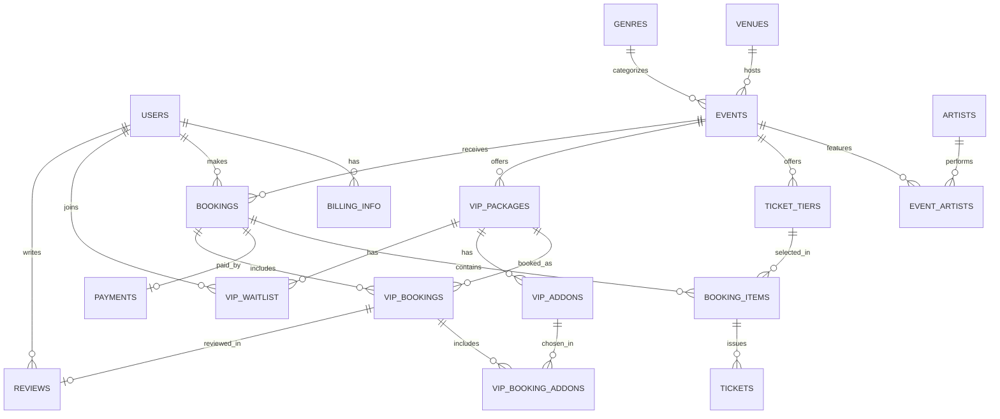

# Technical Specifications Document

## Title Page

- **Project Name:** Event Booking System with VIP Experience Packages
- **Version:** 1.0 (Draft for client review)
- **Date:** October 19, 2026
- **Author(s):** Bootcamp Group *(replace with group name and member names)*

---

## Table of Contents

1. [Introduction](#1-introduction)
2. [Overall Description](#2-overall-description)
3. [Visual Mockup Reference](#3-visual-mockup-reference)
4. [Features](#4-features)
5. [Functional Requirements](#5-functional-requirements)
6. [Non-Functional Requirements](#6-non-functional-requirements)
7. [Data Requirements](#7-data-requirements)
8. [External Interface Requirements](#8-external-interface-requirements)
9. [Glossary](#9-glossary)
10. [Appendices](#10-appendices)

> Page numbers are not used because this document is a Markdown file; each entry links to its section instead.

---

## 1. Introduction

### 1.1 Purpose
This document specifies the frontend and backend requirements for an Event Booking System for concerts and special events. It is the shared reference for the development team and the business owner (client).

### 1.2 Problem Statement
The business owner wants to build an event booking platform. Beyond standard booking, the owner wants the platform to stand out by rethinking how exclusive VIP packages are offered, especially packages that let customers meet celebrities. The goals are:

- Create a better customer experience.
- Increase the perceived value of VIP packages.
- Offer something more competitive than existing solutions.

### 1.3 Scope
**In scope**
- Public browsing of events (homepage, listings, calendar, event details)
- Customer accounts and profile management
- Ticket booking and payment
- A dedicated VIP Experiences section with an improved VIP package flow
- An admin area for managing events, ticket inventory, and VIP packages

**Out of scope (cut from version 1.0)**
- Secondary ticket resale marketplace (StubHub-style)
- Sports, theater, and family categories (focus is concerts and special events)
- Gift cards and promo-code engine
- Hotel and travel booking
- Native mobile apps (the website is responsive instead)
- Advertising slots (seen in the reference sites)

### 1.4 Intended Audience
Development team, instructor/consultants, the business owner, and future employers viewing this public repository.

### 1.5 References
Live Nation PH, Ticketmaster (including its VIP Guide), and StubHub, as provided by the client. These are used for inspiration only; the product aims to improve on them, not copy them.

---

## 2. Overall Description

### 2.1 Product Perspective
A standalone, responsive web application with a customer-facing site, an admin dashboard, and a backend API with its own database. It integrates with an external payment gateway and an email service.

### 2.2 User Classes

| User | Description |
|---|---|
| Guest | Browses events and the VIP guide without an account |
| Customer | Registered user who books tickets and VIP packages, manages their profile |
| Admin / Event Manager | Creates events, sets inventory, manages VIP packages, bookings, and refunds |
| Super Admin (optional) | Manages admin accounts and system settings |

### 2.3 Operating Environment
Modern desktop and mobile browsers (latest two versions of Chrome, Edge, Firefox, Safari). Backend runs on a cloud-hosted server with a relational database.

### 2.4 Proposed Tech Stack *(to be confirmed by the group)*
- **Frontend:** React (or Next.js), CSS framework of the group's choice
- **Backend:** Node.js with Express (REST API)
- **Database:** PostgreSQL or MySQL
- **Auth:** JWT with hashed passwords
- **Payments:** Third-party gateway supporting cards and e-wallets (e.g., PayMongo, Xendit)
- **Email:** Transactional email provider (e.g., SendGrid)

### 2.5 Assumptions and Constraints
- Prices are shown in Philippine Peso (PHP); other currencies are not supported in v1.0.
- Event data is entered manually by admins (no import from other ticketing sites).
- The project is a bootcamp specification exercise lasting about two weeks; actual implementation is future work.
- Celebrity availability and VIP terms are confirmed offline by the business owner before a VIP package is published.

### 2.6 Open Questions for the Client
1. Which user roles are needed besides customers and admins (e.g., artist managers)?
2. How is VIP inventory limited and who approves VIP purchases?
3. What are the refund rules for standard tickets versus VIP packages?
4. Which payment methods must be supported at launch?
5. Does the client want a seat map, or is general admission by ticket tier enough for v1.0?

---

## 3. Visual Mockup Reference

- **Figma mockup (desktop and mobile, at least 5 pages):** `<add Figma link here>`
- **Typography guide (Figma and Stitch):** `<add link here>`
- **Trello task board:** `<add Trello link here>`

### Planned Wireframe Pages

| # | Page | Based on client reference |
|---|---|---|
| 1 | Homepage | Live Nation homepage: hero carousel, upcoming shows, search by location and date |
| 2 | Event Listings / Calendar | Live Nation listings and calendar: month grouping, filters for location, date, genre |
| 3 | Event Details | Ticketmaster event page: banner, date, venue, FAQ, refund policy, ways to buy |
| 4 | Customer Profile | Ticketmaster profile: personal info, billing, security, tickets |
| 5 | VIP Experiences | Original design: improved VIP guide and package builder (see 4.3) |
| 6 | Checkout and Confirmation | Added page: needed to complete booking |
| 7 | Sign In / Register | Added page: needed for accounts |

---

## 4. Features

### 4.1 Core Booking Features (standard)
1. **Homepage:** hero carousel of featured events and artists, upcoming shows list, quick search by location and date.
2. **Event listings and calendar:** events grouped by month, search by artist or event, filters for location, date, and genre.
3. **Featured events:** admin-controlled promoted events on the homepage.
4. **Event details page:** one page per event with full information, ticket tiers, FAQ, exchange and refund policy, and how to buy.
5. **Accounts:** register, sign in, reset password.
6. **Customer profile:** manage personal info, email, phone, password, billing information, and view tickets and booking history in one place.
7. **Ticket booking and payment:** select quantity and tier, pay online, receive e-ticket with QR code by email.
8. **Admin dashboard:** manage events, venues, artists, ticket tiers, VIP packages, bookings, and reports.

### 4.2 Features Deliberately Left Out (unnecessary for v1.0)
Resale marketplace, gift cards and promo codes, hotel/travel add-ons, ads, sports and theater categories, and native apps. These add complexity without supporting the client's main goal (a better VIP experience).

### 4.3 VIP Experience Features (the differentiator)
The client wants VIP packages that feel more valuable and more exciting than a simple "photo with the artist" listing. Proposed ideas:

1. **VIP Experience Page:** a dedicated page with packages grouped by tier (e.g., Meet & Greet, Special Access, Ultimate) and by event.
2. **Build-Your-Own VIP:** customers start from a base package and add extras (soundcheck access, signed merchandise, backstage tour, premium seating, private lounge, souvenir photo book).
3. **Transparent limited inventory:** a live "slots left" counter and "Extremely Limited" badge so scarcity is visible and honest.
4. **Fair access for VIP slots:** a fan lottery or verified-fan queue option for high-demand packages, to reduce bots and scalping.
5. **Digital VIP Pass:** a personalized pass in the customer's profile with a QR code, a day-of itinerary (arrival time, check-in gate, meet-and-greet slot), and reminders.
6. **VIP timeline:** a step-by-step view of what the customer will experience before, during, and after the show.
7. **Post-event memories:** photos and a thank-you message delivered to the customer's profile after the event.
8. **Waitlist:** join a waitlist for sold-out packages, with automatic notification if slots reopen.
9. **VIP groups:** book for 2 to 4 guests under one package.
10. **Reviews and ratings:** verified VIP attendees can rate their experience, building trust for future buyers.

*Priority for v1.0 (to be confirmed with the client):* items 1, 2, 3, 5 are must-have; items 4, 6, 8, 9 are nice-to-have; items 7 and 10 are future work.

---

## 5. Functional Requirements

Priority: **M** = Must, **S** = Should, **C** = Could.

### 5.1 Frontend

| ID | Requirement | Priority |
|---|---|---|
| FR-F01 | The homepage shall display a hero carousel of featured events with a "More Info" button. | M |
| FR-F02 | The homepage shall display a list of upcoming shows with image, name, and date. | M |
| FR-F03 | The homepage shall provide a search by location and date range that opens filtered results. | M |
| FR-F04 | The listings page shall group events by month and show date, image, title, venue, and a "Find Tickets" button. | M |
| FR-F05 | The listings page shall provide a search field for artist or event name. | M |
| FR-F06 | The listings page shall provide filters for location, date, and genre, applied without a full page reload. | M |
| FR-F07 | Each event shall have its own details page with banner, date and time, venue, description, ticket tiers, FAQ, refund policy, and ways to buy. | M |
| FR-F08 | The user shall be able to sign in, register, and reset a forgotten password. | M |
| FR-F09 | The profile page shall allow the user to update name, email, phone number, password, and billing information. | M |
| FR-F10 | The profile page shall list the user's tickets, VIP passes, and booking history. | M |
| FR-F11 | The checkout page shall show an order summary, collect payment details through the gateway, and show a confirmation page. | M |
| FR-F12 | The VIP Experiences page shall list packages by tier and event, with image, description, inclusions, price, and slots remaining. | M |
| FR-F13 | The VIP package page shall let the user choose add-ons and update the total price in real time. | S |
| FR-F14 | The Digital VIP Pass shall display a QR code and itinerary. | S |
| FR-F15 | The site shall be fully usable on mobile and desktop layouts. | M |
| FR-F16 | Forms shall show clear validation and error messages. | M |

### 5.2 Backend

| ID | Requirement | Priority |
|---|---|---|
| FR-B01 | The system shall provide user registration, login, logout, and password reset with email verification. | M |
| FR-B02 | The system shall enforce role-based access (guest, customer, admin). | M |
| FR-B03 | The system shall provide CRUD for events, venues, artists, genres, and ticket tiers (admin only). | M |
| FR-B04 | The system shall return event lists with search, filter, sorting, and pagination. | M |
| FR-B05 | The system shall manage ticket and VIP inventory and prevent overselling, including when many users book at the same time. | M |
| FR-B06 | The system shall temporarily hold selected tickets (e.g., 10 minutes) during checkout and release them on timeout. | M |
| FR-B07 | The system shall create bookings, process payments through the gateway, and record payment status. | M |
| FR-B08 | The system shall generate a unique QR code for each ticket and VIP pass and send a confirmation email. | M |
| FR-B09 | The system shall support refund and cancellation according to each event's policy. | S |
| FR-B10 | The system shall provide CRUD for VIP packages, add-ons, and slot capacity (admin only). | M |
| FR-B11 | The system shall support a waitlist for sold-out VIP packages and notify users when slots open. | C |
| FR-B12 | The system shall support a fan lottery or verified-fan queue for selected VIP packages. | C |
| FR-B13 | The system shall let admins validate tickets by scanning or entering the QR code at entry. | S |
| FR-B14 | The system shall give admins basic reports: sales per event, VIP slot usage, revenue. | S |
| FR-B15 | The system shall log important actions (logins, payments, refunds, admin changes). | S |

### 5.3 Example User Flow: Booking a VIP Package
1. The customer opens the VIP Experiences page and selects a package.
2. The customer picks add-ons and the number of guests.
3. The system checks slot availability and holds the slots for 10 minutes.
4. The customer signs in (or registers) and pays.
5. The system confirms payment, issues the Digital VIP Pass, and emails the confirmation.
6. The pass and itinerary appear in the customer's profile.

---

## 6. Non-Functional Requirements

### 6.1 Performance
- Main pages load in under 3 seconds on a typical broadband connection.
- API responses for search and listings return within 500 ms for 95% of requests under normal load.
- The system supports at least 1,000 concurrent users during popular ticket releases.

### 6.2 Security
- Passwords are hashed (e.g., bcrypt) and never stored in plain text.
- All traffic uses HTTPS.
- Card details are handled only by the payment gateway; the system never stores full card numbers.
- Input is validated and sanitized to prevent SQL injection and XSS; CSRF protection is applied.
- Role-based access control protects admin endpoints.
- Rate limiting and bot protection on login, registration, and VIP purchase endpoints.
- Compliance with the Philippine Data Privacy Act of 2012 for personal data.

### 6.3 Usability and Accessibility
- Consistent navigation and clear calls to action ("Find Tickets", "Book VIP").
- Responsive design for mobile, tablet, and desktop.
- Meets WCAG 2.1 AA basics: color contrast, keyboard navigation, alt text.
- A customer can go from the homepage to a completed booking in no more than 5 steps.

### 6.4 Reliability and Availability
- Target uptime of 99.5%.
- Automated daily database backups.
- Payments are idempotent so a customer is never charged twice for one booking.

### 6.5 Scalability and Maintainability
- Frontend and backend are separate so they can scale independently.
- Code follows a style guide, with reviewed pull requests and meaningful commit messages.
- Configuration (keys, URLs) is stored in environment variables, not in code.

### 6.6 Compatibility
Latest two versions of Chrome, Edge, Firefox, and Safari; iOS and Android mobile browsers.

---

## 7. Data Requirements

### 7.1 Data Storage
A relational database (PostgreSQL or MySQL) stores users, events, tickets, bookings, payments, and VIP data. Images and media are stored in file or cloud storage with URLs saved in the database.

### 7.2 Main Entities

| Entity | Key fields |
|---|---|
| users | id, first_name, last_name, email, phone, password_hash, role, created_at |
| billing_info | id, user_id, billing_name, address, city, country |
| artists | id, name, bio, image_url |
| genres | id, name |
| venues | id, name, city, address, capacity |
| events | id, title, description, banner_url, venue_id, genre_id, start_datetime, status, is_featured, refund_policy |
| event_artists | event_id, artist_id |
| ticket_tiers | id, event_id, name, price, quantity_total, quantity_available |
| bookings | id, user_id, event_id, total_amount, status, created_at |
| booking_items | id, booking_id, ticket_tier_id, quantity, unit_price |
| tickets | id, booking_item_id, qr_code, status |
| payments | id, booking_id, provider, provider_reference, amount, status, paid_at |
| vip_packages | id, event_id, name, tier, description, base_price, slots_total, slots_available, is_limited |
| vip_addons | id, vip_package_id, name, description, price |
| vip_bookings | id, booking_id, vip_package_id, guest_count, qr_code, itinerary, status |
| vip_booking_addons | vip_booking_id, vip_addon_id |
| vip_waitlist | id, vip_package_id, user_id, status, created_at |
| reviews | id, user_id, vip_booking_id, rating, comment |

### 7.3 Entity-Relationship Diagram

*(Rendered automatically by GitHub. Replace or supplement with your exported ERD image/link.)*

### 7.4 Data Rules
- Emails are unique per user.
- `quantity_available` and `slots_available` can never go below zero.
- A booking is created as `pending`, becomes `confirmed` after successful payment, and `cancelled` or `refunded` otherwise.
- Personal data is retained only as long as needed and can be deleted on request.

---

## 8. External Interface Requirements

### 8.1 User Interfaces
Screens follow the Figma mockup (Section 3): Homepage, Event Listings/Calendar, Event Details, Sign In/Register, Customer Profile, VIP Experiences, Checkout, and Admin Dashboard. Each screen has a desktop and mobile layout and uses the shared typography guide.

### 8.2 Sample REST API Endpoints

| Method | Endpoint | Purpose |
|---|---|---|
| POST | `/api/auth/register` | Create account |
| POST | `/api/auth/login` | Sign in |
| POST | `/api/auth/forgot-password` | Request password reset |
| GET | `/api/events` | List events (search, filter, paginate) |
| GET | `/api/events/featured` | Featured events for homepage |
| GET | `/api/events/:id` | Event details |
| GET | `/api/events/:id/vip-packages` | VIP packages for an event |
| GET | `/api/vip-packages` | All VIP packages (VIP page) |
| POST | `/api/bookings` | Create booking and hold inventory |
| POST | `/api/payments/checkout` | Start payment |
| POST | `/api/payments/webhook` | Receive payment gateway result |
| GET | `/api/me` | Get own profile |
| PUT | `/api/me` | Update own profile |
| GET | `/api/me/tickets` | Own tickets and VIP passes |
| POST | `/api/vip-packages/:id/waitlist` | Join VIP waitlist |
| POST | `/api/admin/events` | Create event (admin) |
| PUT | `/api/admin/events/:id` | Update event (admin) |
| POST | `/api/admin/vip-packages` | Create VIP package (admin) |
| POST | `/api/admin/tickets/validate` | Validate QR at entry (admin) |

### 8.3 Interactions with Other Systems
- **Payment gateway:** processes payments and sends results through a webhook.
- **Email service:** sends verification, confirmation, reminder, and waitlist emails.
- **Storage/CDN:** hosts event and VIP images.
- **Map or location service (optional):** shows venue location on the event page.

### 8.4 Hardware Interfaces
Mobile phone cameras or QR scanners for ticket validation at entry. No other special hardware is required.

---

## 9. Glossary

| Term | Definition |
|---|---|
| TSD | Technical Specifications Document |
| ERD | Entity-Relationship Diagram showing database tables and their relationships |
| VIP Package | A premium paid experience attached to an event, such as a meet and greet or special access |
| Meet & Greet | A VIP package that lets customers meet an artist, usually with a photo |
| Special Access | A VIP package with perks such as backstage tours, lounges, or soundcheck |
| Ticket Tier | A category of ticket for an event with its own price and quantity |
| Digital VIP Pass | An electronic pass with QR code and itinerary for a VIP booking |
| Waitlist | A queue for customers who want a package that is sold out |
| Verified-Fan Queue / Lottery | A fair-access method that randomly or selectively assigns scarce slots |
| QR Code | A scannable code used to validate tickets at entry |
| REST API | A web interface in which the frontend requests data from the backend over HTTP |
| JWT | JSON Web Token, used for secure sign-in sessions |
| CRUD | Create, Read, Update, Delete |
| WCAG | Web Content Accessibility Guidelines |
| MVP | Minimum Viable Product: the smallest version that delivers the core value |

---

## 10. Appendices

### Appendix A: Linked Deliverables
- Trello Task Board: [TRELLO](https://trello.com/b/SvNXWoQ7/mcp-side-project)
- ERD (exported image/file): `<add link>`
- Figma wireframes (mobile and desktop, 5+ pages): `<add link>`
- Typography guide (Figma and Stitch): `<add link>`

### Appendix B: Client Reference Summary

| Reference | What the client liked |
|---|---|
| Live Nation PH, homepage | Immediately highlights upcoming events and featured artists |
| Live Nation PH, listings | Easy to browse; little time spent searching |
| Live Nation PH, calendar | Find events by what you want without scrolling through everything |
| Ticketmaster, featured events | Strong promotion of featured events |
| Ticketmaster, event details | Own page per event with complete information |
| Ticketmaster, profile | Manage personal information in one place |
| Ticketmaster, VIP guide | Inspired the business; wants a dedicated VIP page, with the exact flow still to be defined |
| Ticketmaster, Meet & Greet and Special Access | Likes the presentation; wants something more exciting, not a copy |

### Appendix C: Revision History

| Version | Date | Author(s) | Changes |
|---|---|---|---|
| 1.0 | October 19, 2026 | Bootcamp Group | Initial draft for client review |
